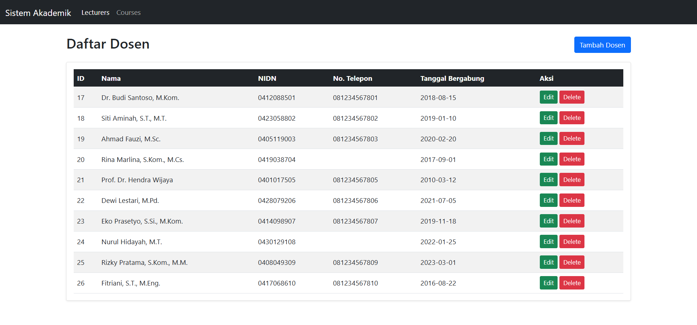
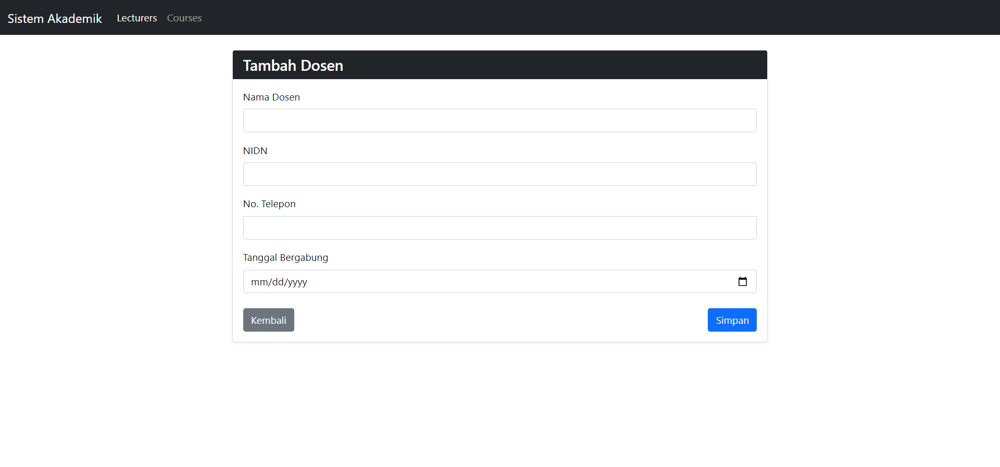
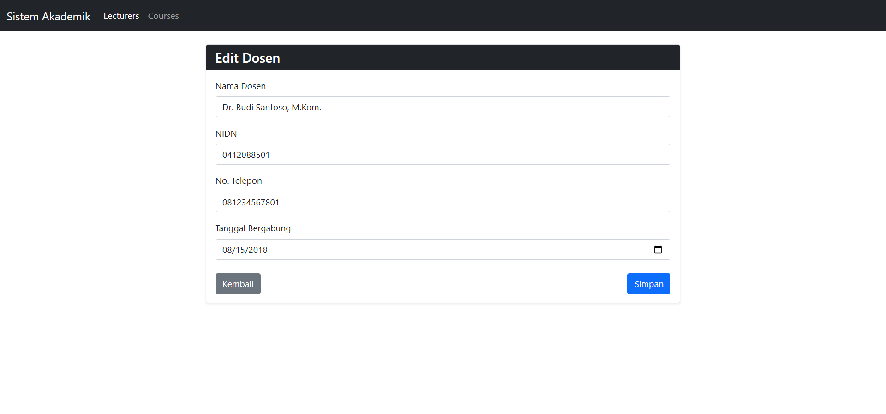
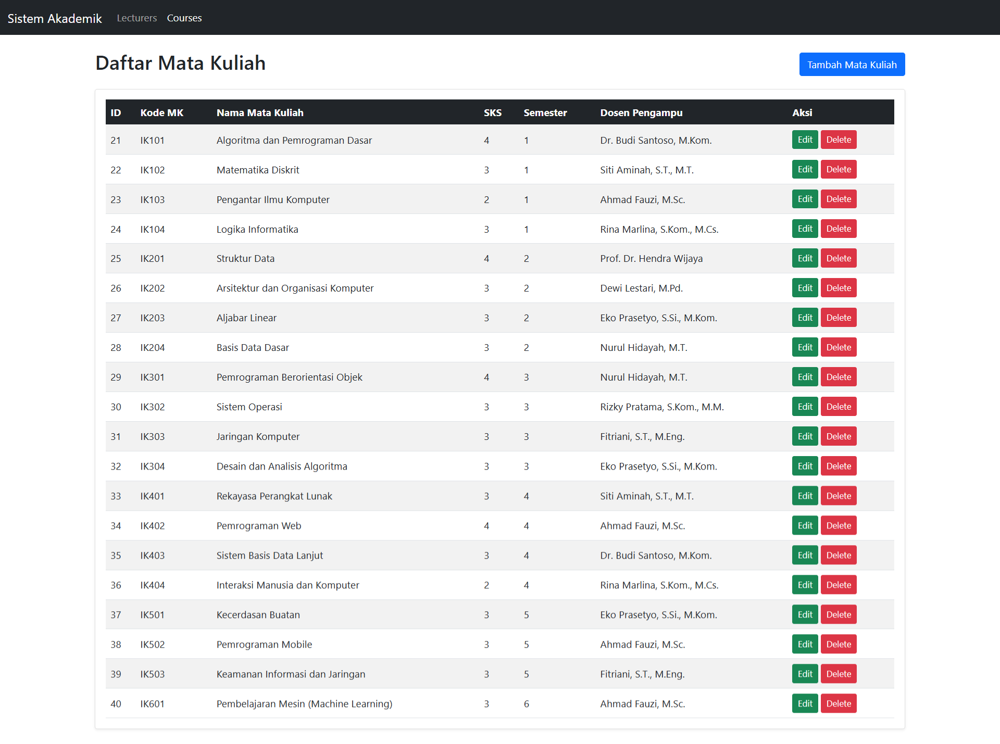
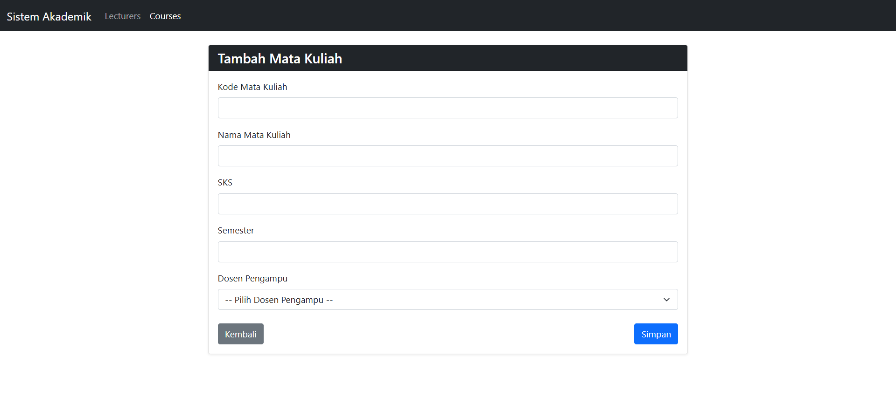
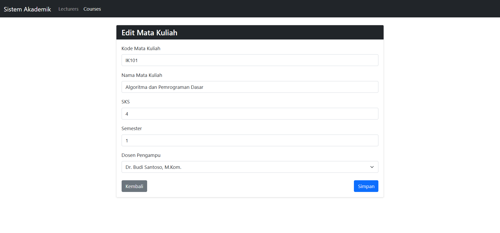
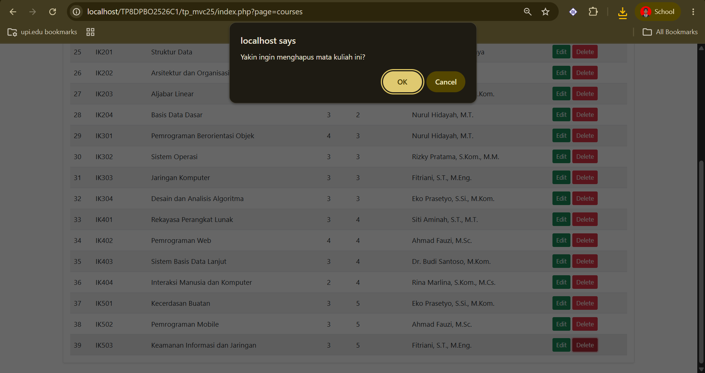

# TP8DPBO2526C1 - Sistem Manajemen Dosen & Mata Kuliah (Arsitektur MVC)

Program aplikasi web sederhana berbasis PHP native dan MySQL untuk mengelola data dosen dan mata kuliah dengan menerapkan pola arsitektur **Model-View-Controller (MVC)**.

---

## 1. Desain Program

Program ini dirancang menggunakan konsep pemrograman berorientasi objek (OOP) dan memisahkan logika aplikasi ke dalam pola arsitektur **MVC (Model-View-Controller)** agar struktur kode rapi, modular, dan mudah dipelihara.

### A. Struktur Arsitektur (MVC)

1. **Model (`tp_mvc25/models/`)**
   - Bertanggung jawab atas pengelolaan data dan interaksi langsung dengan basis data MySQL.
   - **`DB.php`**: Kelas dasar pembungkus koneksi basis data (mysqli) yang menyediakan metode koneksi dan eksekusi query (`open`, `execute`, `getResult`, `close`).
   - **`Lecturers.php`**: Mewarisi kelas `DB`, menangani operasi CRUD untuk tabel dosen (`lecturers`).
   - **`Courses.php`**: Mewarisi kelas `DB`, menangani operasi CRUD untuk tabel mata kuliah (`courses`) serta penggabungan (*LEFT JOIN*) dengan tabel dosen.

2. **View (`tp_mvc25/views/` & `tp_mvc25/templates/`)**
   - Bertanggung jawab atas penyajian data ke dalam antarmuka visual (UI) pengguna.
   - **`Template.php`**: Mesin template sederhana yang membaca berkas HTML dan mengganti placeholder (seperti `DATA_THEAD`, `DATA_TBODY`, `DATA_FORM_INPUTS`, dll.) dengan konten dinamis.
   - **`LecturerView.php`**: Menyiapkan tampilan daftar dosen dan form tambah/edit dosen ke dalam template.
   - **`CoursesView.php`**: Menyiapkan tampilan daftar mata kuliah dan form tambah/edit mata kuliah (termasuk daftar pilihan dropdown dosen pengampu).
   - **`templates/index.html` & `templates/form.html`**: Berkas template HTML berbasis Bootstrap sebagai kerangka tampilan halaman tabel dan formulir.

3. **Controller (`tp_mvc25/controllers/`)**
   - Bertindak sebagai pengendali utama logika bisnis dan penghubung antara Model dan View.
   - **`LecturersController.php`**: Mengontrol alur data dosen (menampilkan daftar, memproses penambahan, pengubahan, serta penghapusan data dosen).
   - **`CoursesController.php`**: Mengontrol alur data mata kuliah (mengambil data dari model `Courses` dan `Lecturers`, lalu menyajikannya ke tampilan terkait).

4. **Router / Entry Point (`tp_mvc25/index.php`)**
   - Berfungsi sebagai gerbang utama (entry point) aplikasi web.
   - Menangkap parameter dari URL (`page`, `action`, dan `id`), kemudian mengarahkan permintaan ke controller dan metode yang tepat.

### B. Struktur Basis Data (Relasi Antar Tabel)

Basis data `tp_mvc25` terdiri dari dua tabel utama yang saling berelasi:
- **`lecturers`**: Menyimpan data dosen dengan kolom `id` (Primary Key), `name`, `nidn` (Unique), `phone`, dan `join_date`.
- **`courses`**: Menyimpan data mata kuliah dengan kolom `id` (Primary Key), `course_code` (Unique), `course_name`, `credits`, `semester`, dan `lecturer_id` (Foreign Key).
- **Relasi**: Foreign Key `courses.lecturer_id` merujuk pada `lecturers.id` (Relasi *One-to-Many*: satu dosen dapat mengampu beberapa mata kuliah).

---

## 2. Alur Cara Kerja Program

### A. Alur Siklus Permintaan (Request Lifecycle)

```
[ Pengguna / Browser ]
          │ (Request URL: page, action, id)
          ▼
   [ index.php ] ──(Routing)──► [ Controller ]
                                   │       ▲
                  (Query Data)     │       │ (Data Array)
                  ▼                ▼       │
             [ Model ] ◄───► [ Database ]  │
                  │                        │
                  └────────(Kirim Data)────┘
                                   │
                                   ▼
                            [ View & Template ]
                                   │
                                   ▼ (Render HTML)
                         [ Tampilan Browser ]
```

1. **Permintaan Pengguna (Request)**: Pengguna mengakses URL tertentu di browser (misal: `index.php?page=courses&action=index`).
2. **Pemeriksaan Rute (Routing)**: Berkas `index.php` membaca parameter `page` untuk menentukan controller (`LecturersController` atau `CoursesController`) dan parameter `action` untuk menentukan aksi yang akan dieksekusi.
3. **Pemrosesan pada Controller**:
   - Jika meminta tampilan, Controller meminta data ke Model, lalu mengirimkan hasilnya ke View.
   - Jika menerima kiriman formulir (POST), Controller memanggil fungsi penyimpanan/pembaruan pada Model, lalu mengalihkan (*redirect*) halaman kembali ke daftar data.
4. **Penyajian Tampilan (Render View)**: View menyuntikkan data ke dalam berkas template HTML (`Template.php`) dan mengirimkan output HTML bersih ke browser pengguna.

### B. Alur Kerja Fitur CRUD

1. **Menampilkan Data (Read)**:
   - Pengguna membuka halaman utama modul (`index`).
   - Controller membuka koneksi database dan mengambil seluruh data dari Model.
   - Data disusun dalam bentuk baris tabel oleh View dan disajikan kepada pengguna.
2. **Menambah Data (Create)**:
   - Pengguna membuka tombol tambah (`action=add`).
   - View menyajikan form input kosong (pada form mata kuliah, data dosen diambil untuk opsi pilihan).
   - Pengguna mengisi form dan menekan tombol simpan (*Submit POST*).
   - Controller meneruskan data ke Model untuk dijalankan perintah `INSERT INTO`, kemudian halaman dialihkan ke halaman indeks.
3. **Mengubah Data (Update)**:
   - Pengguna menekan tombol *Edit* pada salah satu baris (`action=edit&id=...`).
   - Controller mengambil data spesifik berdasarkan `id` melalui Model.
   - View menyajikan form yang nilainya telah terisi data lama.
   - Saat disimpan, Controller memanggil fungsi update pada Model dengan perintah `UPDATE ... WHERE id = ...`.
4. **Menghapus Data (Delete)**:
   - Pengguna menekan tombol *Delete* pada baris data (`action=delete&id=...`) dan mengonfirmasi dialog.
   - Controller memerintahkan Model menjalankan `DELETE FROM ... WHERE id = ...`.
   - Data berhasil dihapus dan tampilan diperbarui.

---

## 3. Dokumentasi

1. Daftar Dosen <br>
 

2. Form Tambah Dosen <br> 
 

3. Form Edit Dosen <br>
 

4. Daftar Mata Kuliah <br>
 

5. Form Tambah Mata Kuliah <br>
 

6. Form Edit Mata Kuliah <br>
 

7. Penghapusan Data <br>
 

8. Link Record (Google Drive) <br>
[Link](https://drive.google.com/file/d/1f1sRoMspjrtnDpZBoLaJAh5xAsfH47S3/view?usp=sharing)